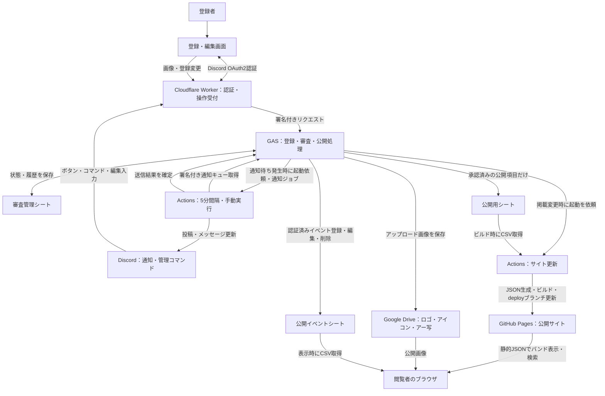
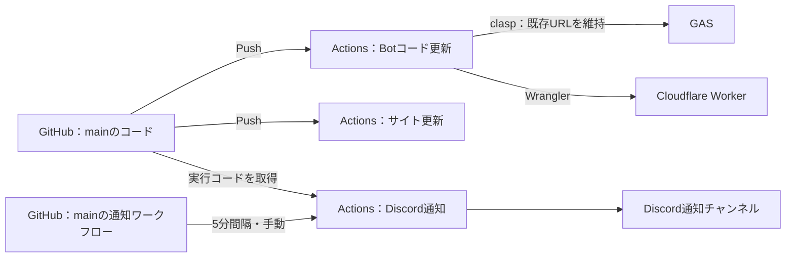

# VRC Band DB システム構成

2026-11-23更新。Discord通知はGitHub Actionsへ移行済み。PCの常駐通知タスクは停止・無効化している。バンド情報はビルド時にJSON化し、イベント情報は表示時に公開シートから取得する。

## データと操作の流れ

- **GAS**がデータ処理の中心。登録画面・Discord管理コマンドから受けた情報を保存し、所有権・審査状態を管理する。承認済み情報だけを公開用シートへ反映する。
- **通知Actions**がDiscordへの投稿担当。GASから取得し、送信後に結果を確定する。通知待ちは非公開の審査管理シートに残るため、runnerのファイル保存に依存しない。GASからも登録等の成功時と5分メンテナンス時に起動を依頼する。GitHub側の混雑による遅延はあり得る。
- **Worker**はDiscordログイン、登録画面API、Discord操作の受付担当。管理人ロールと本人所有権に応じて操作を制限する。
- **公開サイト**のバンド情報は生成済みJSON。イベントカレンダーだけは公開イベントCSVを表示時に読む。登録・編集はWorker経由でGASへ送る。

## シートの構成

| スプレッドシート | 内容 |
| --- | --- |
| [審査管理](https://docs.google.com/spreadsheets/d/1fvBBgXQszwi1nv_pISCO6z1y9qY99uPxN4tRyCpe6yI/edit) | 下記の管理タブ。審査状態や履歴を保持する非公開の管理用ファイル |
| [公開用](https://docs.google.com/spreadsheets/d/1jN3Ujug7ANHsoryi5sNvNDFH3tLWaI_Uoy01zcveH9c/edit) | 公開用タブ（gid=0）。承認済み情報と公開用ID・版だけ。サイトActionsが取得 |
| [イベント用](https://docs.google.com/spreadsheets/d/1MSWnv5mYUI9cxhnnm7hq6i214zbpW7Ad8rky6s10hXo/edit) | Eventsタブ。公開イベント項目のみ。ビルド時JSON化なし |
| [テスト用](https://docs.google.com/spreadsheets/d/1DzdgqNtbOWJ6PAF1QusKWaeD-vmw7pfLBOJr-8WUiXI/edit) | テストモードで使う別データ。本番フローには含めない |

審査管理シート内のタブ：

| タブ | 役割 |
| --- | --- |
| Registrations | 登録ID、所有者、登録元、最新内容、承認済み内容、票、通知・公開待ち、応急編集等 |
| Audit | 版・審査状態の履歴。従来の削除データを復元するときの承認履歴にも使う |
| ReviewVotes | 誰が承認・却下へ投票したか |
| AdminEdits | 管理人の応急編集の前後の値・項目・操作者 |
| Nonces | 署名付きリクエストの再利用を防ぐ記録 |
| WebUsers | Discord ID・ユーザー名・表示名。所有者検索に使用 |
| WebSessions | 登録画面のセッションと期限 |

## Actionsは3系統

| ワークフロー | 起動条件 | 更新するもの |
| --- | --- | --- |
| Discord notifications（discord-notify.yml） | GASからの起動依頼、5分間隔・手動実行 | GAS通知キュー取得→Discord投稿・更新→GASへ結果確定 |
| Deploy Vue SPA to deploy（deploy-spa.yml） | mainへのPush、手動実行、GASからの起動依頼 | 公開用CSV→JSON生成→サイトのビルド→deployブランチへ公開 |
| Deploy Discord integration（deploy-discord.yml） | mainへの関連コードのPush、手動実行 | テスト後、変更したGAS・Workerのコードを配置。自動配置はDISCORD_DEPLOY_ENABLED=true時 |

通知ワークフローは既定ブランチmainに置き、実行コードはmainから取得する。DISCORD_NOTIFIER_ENABLED=trueで自動通知を有効化。Botトークンと通知専用鍵はGitHub Secretsに保存する。GASのNOTIFICATION_TRANSPORT=localは既存キュー経路の名称として維持し、PCは使わない。コマンド定義の追加・変更は通知処理に含まれず、別途RegisterCommandsによる登録更新が必要。毎日の定時サイト更新は設定していない。

## 審査・編集の扱い

- 通知チャンネルで、モデレーターは既定3人の同じ結論で確定。管理人は1人で確定。未確定票では公開しない。
- 管理人専用チャンネルで検索・掲載削除・復元・応急編集。掲載削除後も復元用の登録情報・履歴は残す。
- 登録画面とDiscordの応急編集から内容を変更できる。変更内容を審査し、掲載には承認済み内容だけを使う。
- 画像はWorker→GAS経由で既存Driveフォルダへ保存し、公開画像URLで参照する。外部URL入力にも対応。画像本体はGitHubへ取り込まない。Discordで表示できない画像は確認リンクから開く。
- Worker→GASと通知Actions→GASは別の共有鍵で署名。Bot Token等は公開ソース・公開シートへ入れない。

本番ビルドにはVRC_BAND_DB_APPROVED_SHEET_URLとVRC_BAND_DB_REQUIRE_APPROVEDを設定し、承認済みの公開用シートを使用する。

詳細：[審査・コマンド](VRC-Band-DB-discord-moderation.md)／[応急編集](VRC-Band-DB-discord-edit.md)／[Actions通知](VRC-Band-DB-discord-actions-notifier.md)／[登録・認証](VRC-Band-DB-self-service.md)／[イベント](VRC-Band-DB-live-events.md)／[Actions設定](VRC-Band-DB-discord-ci.md)
