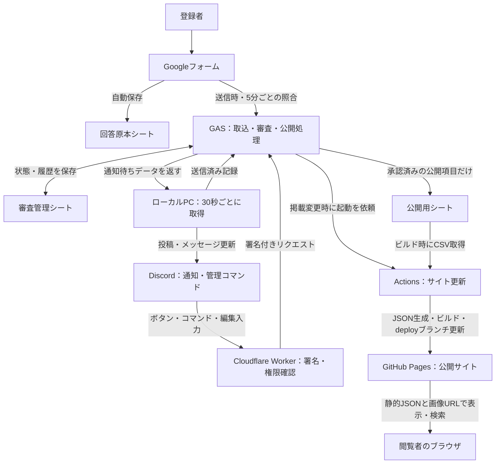
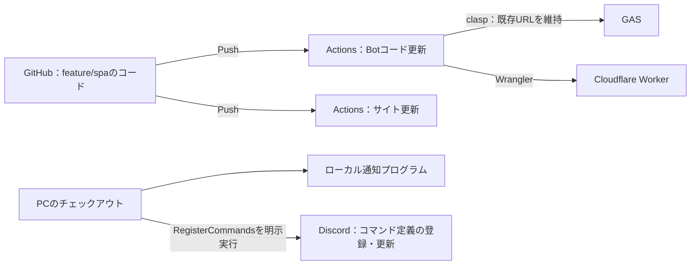

# VRC Band DB システム構成

2026-11-19時点の実装。以下は、本番Actionsで承認済み公開シートを使用し、Discord通知をローカルPCから送る構成。

## データと操作の流れ

- **GAS**がデータ処理の中心。回答の取り込み元はGoogleフォームのAPIで、原本の回答シートを直接読んで審査する方式ではない。
- **PC**はDiscordへの投稿担当。停止中は通知が保留され、再開後に送信する。審査・公開データはPCに保存しない（送信済み記録と暗号化した認証情報は保持）。
- **Worker**はDiscord操作の受付担当。GASの処理結果を操作者本人にも返す。
- **公開サイト**は静的ファイル。閲覧のたびにフォーム・GAS・シートを取得する構成ではない。

## シートの構成

| スプレッドシート | 内容 |
| --- | --- |
| [回答原本](https://docs.google.com/spreadsheets/d/1fwkoyzz8c82Soh-2WKxwMLl_oMmb-u_cnC5cc6aMP9Y/edit) | フォーム回答の自動保存先。Botから直接編集・削除しない |
| [審査管理](https://docs.google.com/spreadsheets/d/1fvBBgXQszwi1nv_pISCO6z1y9qY99uPxN4tRyCpe6yI/edit) | 下記5タブ。審査状態や履歴を保持する非公開の管理用ファイル |
| [公開用](https://docs.google.com/spreadsheets/d/1jN3Ujug7ANHsoryi5sNvNDFH3tLWaI_Uoy01zcveH9c/edit) | 公開用タブ（gid=0）。承認済み情報と公開用ID・版だけ。サイトActionsが取得 |
| [テスト用](https://docs.google.com/spreadsheets/d/1DzdgqNtbOWJ6PAF1QusKWaeD-vmw7pfLBOJr-8WUiXI/edit) | テストモードで使う別データ。本番フローには含めない |

審査管理シート内のタブ：

| タブ | 役割 |
| --- | --- |
| Registrations | 登録ID、フォーム回答ID、最新内容、承認済み内容、票、通知・公開待ち、応急編集等 |
| Audit | 版・審査状態の履歴。従来の削除データを復元するときの承認履歴にも使う |
| ReviewVotes | 誰が承認・却下へ投票したか |
| AdminEdits | 管理人の応急編集の前後の値・項目・操作者 |
| Nonces | 署名付きリクエストの再利用を防ぐ記録 |

## Actionsは2系統

| ワークフロー | 起動条件 | 更新するもの |
| --- | --- | --- |
| Deploy Vue SPA to deploy（deploy-spa.yml） | feature/spaへのPush、手動実行、GASからの起動依頼 | 公開用CSV→JSON生成→サイトのビルド→deployブランチへ公開 |
| Deploy Discord integration（deploy-discord.yml） | feature/spaへの関連コードのPush、手動実行 | テスト後、変更したGAS・Workerのコードを配置。自動配置はDISCORD_DEPLOY_ENABLED=true時 |

ActionsからPCのプログラムを自動配布・再起動する仕組みはない。コマンド追加・入力欄変更時は、PCでもコードを更新し、保存済み認証情報でRegisterCommandsを再実行する。現状、毎日の定時サイト更新は設定していない。

## 審査・編集の扱い

- 通知チャンネルで、モデレーターは既定3人の同じ結論で確定。管理人は1人で確定。未確定票では公開しない。
- 管理人専用チャンネルで検索・掲載削除・復元・応急編集。削除しても原本・履歴は残す。
- 応急編集は審査側で保持し、フォームの同じ項目が修正されたらフォーム側を優先。掲載には承認済み内容だけを使う。
- 画像は登録されたDrive等のURLを参照する。画像本体をGitHubへ取り込む処理や、Driveの共有権限の自動変更はない。Discordで表示できない画像は確認リンクから開く。
- Worker→GASとPC→GASは別の共有鍵で署名。Bot Token等は公開ソース・公開シートへ入れない。

補足：通常のローカルビルドは、公開用シートの環境変数が未設定なら従来の回答原本シートを取得する。上の本番フローにはVRC_BAND_DB_APPROVED_SHEET_URLとVRC_BAND_DB_REQUIRE_APPROVEDの設定を使用する。

詳細：[審査・コマンド](VRC-Band-DB-discord-moderation.md)／[応急編集](VRC-Band-DB-discord-edit.md)／[ローカル通知](VRC-Band-DB-discord-local-notifier.md)／[Actions設定](VRC-Band-DB-discord-ci.md)
