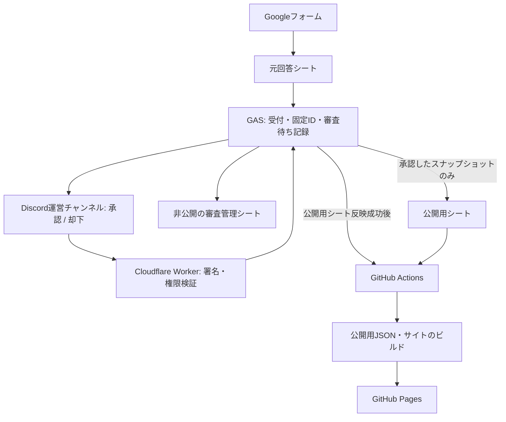

# VRC Band DB Discord通知・承認連携 仕様案

作成日：2026年11月18日  
状態：GAS・Worker・承認データ取込・Actions定義を実装済み。ローカルテストとビルドを確認。外部設定・本番の取込先切替・実アカウントでの連携試験は未実施。

導入順序は [設定・運用手順](VRC-Band-DB-discord-setup.md) を参照。

## 1. 目的と範囲

- Googleフォームへの回答をDiscordの運営チャンネルへ通知する。
- 運営メンバーが通知の「承認」「却下」ボタンで審査する。
- 承認した内容だけをサイト公開用データへ反映し、GitHub Actionsを起動する。
- 常時稼働するBotサーバーは置かず、GASとサーバーレスのHTTP受付を使う。
- 初期版の却下は削除ではなく非掲載とする。物理削除・リアクション操作・スラッシュコマンドは追加機能とする。

## 2. 現在の実装と変更点

| 項目 | 現在 | 導入後 |
| --- | --- | --- |
| 取込元 | 元回答シートのCSV | 承認時に作成した公開用シートのCSV |
| JSON作成 | ビルド時 | 維持 |
| 画面表示 | 生成済みJSONを取得 | 維持。Bot・シートへ直接接続しない |
| 公開起動 | feature/spaへのpush | pushに加え、承認後のworkflow_dispatch |
| 却下 | 処理なし | 非掲載として履歴を保存 |

現行ファイル：

- `SI-HP/scripts/band-source.mjs`：本番・テストの取込先。
- `SI-HP/scripts/band-data.mjs`：公開項目への変換。
- `.github/workflows/deploy-spa.yml`：テスト・シート取得・ビルド・deployブランチ更新。
- リポジトリ：`LyceeSerie/SerieIndustry`。ローカルのorigin/HEADはmainを指すが、導入時にGitHub側の既定ブランチを再確認する。

## 3. 構成

### 役割

| 部品 | 担当 |
| --- | --- |
| GAS | 回答受付、審査状態、公開用シート更新、Discord通知、Actions起動・再試行 |
| Discordアプリ | Bot名・アイコン、運営チャンネルへの投稿、承認・却下ボタン |
| Cloudflare Worker | Discord Interactions受付、署名確認、運営権限確認、GASへの認証付き転送 |
| GitHub Actions | 公開用シートを再取得し、既存手順でテスト・ビルド・公開 |

GASはフォーム送信時のインストール型トリガーを使用する。DiscordのHTTP署名検証はWorkerで行い、GASに直接Discordの受付を任せない。

## 4. データと公開の境界

### 4.1 元回答シート

- フォームの回答先は維持する。元の入力内容を受け取るための場所。
- 現在はリンクを知っている人が閲覧できる運用。審査制を導入しても元回答の閲覧制限が強化されるわけではない。
- 審査ログや却下理由は元回答シートへ書かない。
- 行番号や活動名を登録の識別子にしない。並べ替え・同名登録に対応するため固定UUIDを用いる。

### 4.2 非公開の審査管理シート

元回答とは別のスプレッドシートとし、運営担当者とGAS実行者だけが閲覧できるようにする。

| 項目 | 内容 |
| --- | --- |
| registrationId | 登録単位の固定UUID |
| responseId | Googleフォームの回答ID |
| revision | 回答内容の版。変更時に増加 |
| contentHash | 公開対象項目の正規化済み内容から算出したハッシュ |
| snapshot | 審査対象の内容。公開用項目だけを保持 |
| reviewStatus | pending / approved / rejected |
| discordChannelId / discordMessageId | 通知先と通知メッセージ |
| reviewedBy / reviewedAt | 操作したDiscordユーザーID・UTC日時 |
| lastInteractionId | 二重処理の判定に使うDiscord操作ID |
| publishStatus | not_needed / queued / dispatched / failed |
| lastError / retryCount | 再試行に必要な情報。秘密情報は含めない |

受付はフォーム側の送信イベントを使い、回答IDを取得する。UUID・版・通知の対応は管理シートへ保存する。

### 4.3 公開用シート

- 元回答とは別の公開専用スプレッドシートを用意し、CSV取得可能にする。
- 公開可能な列のみを承認時にコピーする。メール収集列・回答時刻・却下理由・DiscordユーザーID・秘密情報は入れない。
- 現行パーサーが使う見出しを維持する。登録UUIDを保持する場合は公開可能な管理IDとして扱う。
- 常に「最後に承認した内容」のコピーを保持する。回答元への動的参照式や、元回答全体への自動同期は使わない。
- 本番ビルドの取得先をこの公開用シートに変更する。元回答シートを直接読む経路は残さない。

**重要：承認フラグだけではなく承認時の内容を固定する。** 元回答が編集された際に、未審査の変更が次のビルドで公開されることを防ぐ。

## 5. 通知と操作

### 新しい回答

1. responseIdから登録を特定する。新規ならUUIDを発行する。
2. 公開項目の内容を正規化し、ハッシュとスナップショットを保存する。
3. 同じ回答ID・同じハッシュなら重複受付として通知しない。
4. pendingとして、Discordへ通知する。

通知内容：活動名、活動形態、メイン／サブジャンル、登録ID、版、確認用の回答概要。「承認」「却下」のボタンを付ける。

- 長文はDiscordの上限内に省略する。応募者の文字列からメンションを発生させない（allowed_mentionsを制限）。
- ボタンのcustom_idには操作種別・UUID・版を含め、秘密情報は入れない。

### 承認

1. WorkerでDiscord署名と操作権限を検証する。
2. 3秒以内に受付応答し、後続処理を非同期で行う。
3. GASで登録ID・版・状態を確認し、ロック下で最新pendingだけを確定する。
4. 公開用シートへその版のスナップショットを反映する。
5. 反映成功後にpublishStatusをqueuedにし、Actionsを起動する。
6. Discordの通知を「承認済み・公開処理受付」に更新し、ボタンを無効にする。

「承認済み」と「サイトへの反映完了」は別。Actionsの受付成功だけで公開完了とは表示しない。初期版の完了確認はActions実行結果と公開サイトで行う。

### 却下

- pendingの版をrejectedにし、通知を更新、ボタンを無効にする。
- 新規登録は公開用シートに追加しない。公開内容に変化がないため通常はActionsを起動しない。
- 更新申請の却下では、前回承認済みの内容を維持する。公開済み情報を取り下げたい場合は別操作として扱う。
- 初期版は元回答行の物理削除を行わない。将来追加する場合は、固定IDによる特定、退避保存、二段階確認を必須にする。シートの行削除とフォーム回答の削除は別操作である。

### 再送・編集・競合

- 回答編集時のイベント動作だけに依存せず、GASの定期照合でもresponseIdとハッシュを確認する。変更検出時は新しいpending版を作り、再審査する。
- 過去版のボタンは無効扱いとし、最新版を案内する。
- 同時承認・却下はGASのロックと状態遷移で直列化する。先に確定した操作だけ有効にする。
- 通知や公開用シート更新の失敗時は再試行可能な状態を残す。確定前に通知だけを承認済みにしない。
- Workerの非同期処理には実行時間上限がある。時間切れでもGAS側の記録を基準に復旧できるようにし、無制限のバックグラウンド処理を前提にしない。

## 6. 権限と接続

- 指定のDiscordサーバー・チャンネル・許可ロールIDのみ操作可能。権限はWorker側で毎回確認し、画面のボタン表示だけに頼らない。
- Discord署名は生のリクエスト本文と署名ヘッダーで検証する。不正署名は401、PINGには所定の応答を返す。
- Worker→GASは本文内のタイムスタンプ・nonce・HMAC署名で認証する。GASで有効時間とnonce再利用を確認する。URLへ秘密値を含めない。
- GAS Webアプリは実行者のシート権限を使う。匿名到達可能なURLであっても、有効な署名なしでは読み書き・Actions起動を行わない。
- GitHubトークンはGASのScript Propertiesへ保管する。対象リポジトリに限定したActions書込権限でworkflow_dispatchを使う。
- Botトークン、Webhook URL、GAS共有鍵、GitHubトークンを公開リポジトリやブラウザへ渡さない。ログにも出さない。

## 7. GitHub Actions

- 既存のfeature/spaへのpush条件は維持し、workflow_dispatchを追加する。
- デフォルトブランチにもdispatch可能なワークフローを配置する。GitHub上の既定ブランチを確認し、起動refは許可した公開元ブランチに固定する。
- 実行前のテストとnpm run buildは維持する。
- デプロイは同じconcurrencyグループで直列化し、公開途中の強制中断は避ける。
- Actions起動に失敗した場合はシートの承認を取り消さず、queued / failedを再送する。既に承認した行を重複追加しない。
- GitHub APIの起動受付とサイト公開は非同期。公開まで数分程度かかる可能性があるため、即時公開の保証はしない。

## 8. 費用・保留事項

- 提案する受付先はCloudflare Workers。Free枠とGAS・GitHub側の上限内での運用を目指す。無制限・将来も無料とは保証しない。
- Cloudflare公式で確認したFree枠は1日100,000リクエスト。GAS実行時間・外部HTTP呼出し等も上限確認が必要。
- 未確定：Discordサーバー／チャンネル／許可ロール、公開用シートID、既存登録の移行判断、回答更新の照合間隔、公開取り下げ機能。
- 自動削除、却下理由入力、Discordへの公開完了通知、GitHub App認証は次段階。

## 9. 受入条件

| ケース | 期待結果 |
| --- | --- |
| 新規回答 | pendingとして1回通知され、公開用シートには未掲載 |
| 権限ありの承認 | 正しいUUID・版だけ公開用シートへ反映しActions受付 |
| 未承認のまま通常push | 未承認情報がJSONへ混入しない |
| 却下 | 公開されず、履歴が残る |
| 権限なし・別チャンネル・不正署名 | データ変更・Actions起動なし |
| 同じ操作の再送・同時操作 | 二重追加・二重確定なし |
| 承認済み回答を編集 | 公開済みコピーは変わらず、変更内容は再審査 |
| 古い版のボタン | 最新版を誤って確定しない |
| 通知・GAS・Actionsの通信失敗 | 状態を保持し再試行可能。公開完了とは表示しない |
| ビルド失敗 | 現行公開サイトを維持し、Actionsで失敗が確認できる |

## 10. 参照

- [Google：インストール型トリガー](https://developers.google.com/apps-script/guides/triggers/installable)
- [Google：Webアプリ](https://developers.google.com/apps-script/guides/web)
- [Google：GASの上限](https://developers.google.com/apps-script/guides/services/quotas)
- [Discord：Interactionsの受付・応答](https://github.com/discord/discord-api-docs/blob/main/developers/interactions/receiving-and-responding.mdx)
- [GitHub：ワークフロー起動API](https://docs.github.com/en/rest/actions/workflows#create-a-workflow-dispatch-event)
- [GitHub：手動実行と既定ブランチ](https://docs.github.com/en/actions/how-tos/manage-workflow-runs/manually-run-a-workflow)
- [Cloudflare：Workersの上限](https://developers.cloudflare.com/workers/platform/limits/)

## 11. 実装時の補足

- 配置先はautomation/discord/gasとautomation/discord/worker。設定と起動入口の実名は導入手順を参照する。
- GASはRegistrationsのrecordJsonに最新版と最後の承認コピーを保存し、Auditへ審査・版の履歴を残す。公開キューの状態はnot_needed／queued／dispatched／failed。
- Workerから決定を保存した後、署名付きflushリクエストで公開用シート更新・Actions起動・通知更新を促す。失敗時は5分ごとのrunMaintenanceが再試行する。
- 新規回答は送信時に取り込み、既存回答・回答編集は30件ずつ巡回照合する。承認直前にも元回答を再取得し、変更があれば旧版の決定を拒否する。
- 公開項目のJSONは12,000文字以内。過大な回答はスナップショットを保存せずエラーにする。
- 公開側の見出しは_registrationId／_approvedRevision／_reviewStatus＋公開項目。承認モードではapprovedのみ取得し、UUIDの重複・不正な版・管理列欠落はエラーにする。
- sourceConfigはVRC_BAND_DB_APPROVED_SHEET_URLを設定した時点で承認モードに切り替わる。VRC_BAND_DB_REQUIRE_APPROVED=trueではURL未設定もエラー。設定なしの通常ローカルビルドは現状維持のため旧取込先を使用する。導入時には両Variablesを設定し、旧取込経路を実運用で使わない。
- workflow_dispatchは承認済みURL必須。公開ブランチはfeature/spaに限定し、その他のrefは実行しない。既定ブランチへの定義配置とRepository Variables設定は人の作業として残る。
- 再送で通知やActionsの受付成功を確認できない場合は重複リクエストが発生し得る。状態更新と公開行はIDで冪等にし、Actionsは直列化して同じ承認コピーを取り込む。
- 現在の公開用JSONを自動で承認扱いにする移行・物理削除は実装していない。

- 初期化処理はステップ別の診断ログを実装。diagnoseIntegrationは読取だけでフォームと両シートを独立確認する。エラー文にはToken・共有鍵を出さず、シートへの書込・Discord通知・Actions起動はしない。

## Botコードの自動更新

- サイト用と分離したdeploy-discord.ymlを追加。feature/spaへの変更時にテスト後、GAS／Workerの変更した部品を配置する。DISCORD_DEPLOY_ENABLED=trueで有効化する。
- GASは既存デプロイIDを更新してURLを保持し、Script Propertiesとトリガーは変更しない。Workerの既存共有鍵も再登録しない。
- 初回認証とGitHub Secrets／Variablesの設定は [自動更新・認証設定](VRC-Band-DB-discord-ci.md) を参照。実配置はまだ行っていない。

### 通知の診断ログ（2026-11-19）
runMaintenanceはフォーム回答数、処理後の管理件数・通知待ち件数・通知失敗件数を記録する。Discord送信のHTTP失敗はEXTERNAL_HTTP_403等のステータスのみ記録し、回答本文・API応答本文・Tokenは記録しない。実行完了でも通知失敗はあり得るため、このログとRegistrationsのrecordJson内lastErrorを確認する。取込失敗はRESPONSE_IMPORT_FAILEDとしてログへ記録する。通知HTTP失敗と秘密値非出力を含むGASテスト9件成功。
