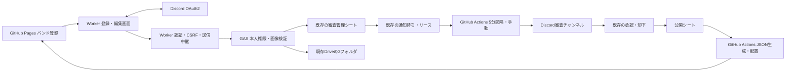

# Discord本人認証・登録編集

## 実装した構成と現在の状態

公開サイトはGitHub Pagesのまま、登録・編集画面を既存Workerの `/register` で配信する。Discord OAuth2の認可コード＋PKCEで本人のDiscord IDを確認し、GASの管理シートから本人所有のバンドだけを返す。画像もブラウザ→Worker→GAS→既存Driveフォルダへ送る。これらの処理にローカルPCは不要。

既存Workerに登録済みのSecret名を読み取り、GAS_HMAC_SECRETだけであることを確認した。実運用のOAuth Client Secret設定・Drive権限承認が未実施のため、本人登録とWorker通知のフラグはfalse、登録ボタンはローカル確認用にregistrationMode=discordへ変更し、Workerの /register へ遷移する。Worker側の有効化・配置前は認証画面を利用できない。認証・所有者・画像・通知はテスト用の応答で検証済みだが、実DiscordのOAuth／通知がCloudflare側から拒否されないかは、有効化時に確認する。GASの新しいDrive権限を承認せず配置すると既存の実行にも認可エラーが出る可能性があるため、先に手順を確認する。



2026-11-23更新：通知はGitHub Actionsへ移行済み。上記の初期導入時のフラグ・未設定事項は導入当時の記録。現在の接続と運用は[システム構成](VRC-Band-DB-architecture.md)と[Actions通知](VRC-Band-DB-discord-actions-notifier.md)を参照。PC通知タスクは停止・無効化済み。

## 初回の設定手順

### 1. Discord OAuth2

既存DiscordアプリのDeveloper Portal → OAuth2 → Redirectsに次を追加する。

```text
https://vrc-band-db-review.serieindustry.workers.dev/auth/callback
```

OAuth2のClient Secretを取得する。Bot Token／公開キーとは別の値。公開コード・チャットへ貼らない。

WorkerのSecretsへ以下を追加する（既存のGAS_HMAC_SECRETは維持）。

```powershell
cd C:\Users\Cubase\Documents\SerieIndustry\automation\discord
npx wrangler secret put DISCORD_CLIENT_SECRET --config worker/wrangler.jsonc
npx wrangler secret put PORTAL_SESSION_SECRET --config worker/wrangler.jsonc
```

PORTAL_SESSION_SECRETはランダム32バイト以上の秘密値。例：PowerShellで次を実行し、コピーされた値をSecret入力欄へ貼る。

```powershell
$portalBytes = [byte[]]::new(32)
$portalRng = [Security.Cryptography.RandomNumberGenerator]::Create()
$portalRng.GetBytes($portalBytes)
$portalRng.Dispose()
Set-Clipboard -Value ([BitConverter]::ToString($portalBytes).Replace('-', '').ToLowerInvariant())
```

### 2. GASの配置・Drive認可

新しいコードとmanifestを配置し、GASエディターで `initializePortalIntegration` を手動実行する。運営の実行アカウントでDriveアクセスを承認する。関数は保存先の読取確認と管理タブ準備だけを行い、画像の作成・移動・共有変更は行わない。

提供された親フォルダ内をDriveツールで確認し、次の3フォルダをコードの既定値として設定済み（本番Script Propertiesへの書き込みは未実施）。必要ならScript Propertiesで上書きできる。

| Script Property | 保存先ID |
|---|---|
| PORTAL_LOGO_FOLDER_ID | 1JRfnhJcPhHKt2T5N5NKTI3Yd-k_oheB-wNBLGTqsvWhjh4p3H8VB01svi00aqpmwTvTzrI0B |
| PORTAL_ICON_FOLDER_ID | 1uiSDdGTidNutU1wDnCfFCXFNG75wqxauDfCpHGFgwkXxRU_q7fijNEvYLZhpkbNN7sdDK8uW |
| PORTAL_PHOTO_FOLDER_ID | 1bsW_QPAdBxPR-GvpdcPJopFbMST5Gq2HiVsQNGwEk9a_9kA0ms845eu4RyXABMZXzg01N57M |

GASのScript Propertiesに `PORTAL_ENABLED=true` を設定する。既存のENABLED等は維持。GASにはDriveスコープを追加しているが、利用者自身のGoogleログインは不要。

### 3. 本人登録を試験公開

`automation/discord/worker/wrangler.jsonc` の `vars.PORTAL_ENABLED` を文字列 `"true"` にし、Workerを配置する。まず `/register` を直接開いてログイン・新規登録・画像送信・編集・他人のデータが見えないことを確認する。

```powershell
npm run deploy:worker --prefix automation/discord
```

OAuthの経路が拒否された場合は `DISCORD_OAUTH_HTTP_403_CODE_40333` 等を返す。ログインが成功したこととBot通知が成功することは別。拒否された場合、PCを使う認証へは迂回しない。既存フォームへの登録ボタンはまだ維持されている。

既存バンドは管理人用チャンネルで次を実行し、本人のDiscord IDへ紐付ける。名前・Xの一致からは自動で権限を渡さない。

```text
/band-owner id:登録ID user:本人
```

コマンド追加時は保存済み認証情報を使い一度登録する。

```powershell
powershell -NoProfile -File .\automation\discord\local\start.ps1 -RegisterCommands
```

このコマンド登録用スクリプトは初回の運営作業だけで、利用者のログイン・登録には不要。band-ownerは既存の所有者を置換し、管理シートへ操作履歴を残す。将来、複数担当者を扱う場合はownerUserIds配列を拡張できる。

### 4. 公開サイトの登録先を切替

`SI-HP/src/config/app-settings.json` を次のように変更してサイトをビルド・配置する。

```json
{
  "vrcBandDb": {
    "discoveryEnabled": true,
    "discoveryCarouselEnabled": true,
    "registrationMode": "discord",
    "registrationUrl": "https://vrc-band-db-review.serieindustry.workers.dev/register"
  }
}
```

`registrationMode=form` に戻せば従来フォームへ戻る。フォームの回答シートや既存記録は削除しない。フォームの受付連携と定期読取を停止する場合はGASの `FORM_SYNC_ENABLED=false` とする。本人編集へ移行したレコードは、定期フォーム読取で上書きしない。

### 5. 通知のPC依存を段階的に外す

WorkerのSecretsに `DISCORD_BOT_TOKEN` と `LOCAL_NOTIFY_SECRET` を追加する。LOCAL_NOTIFY_SECRETは現在GASに設定した通知キュー専用鍵と同じ値。名前は旧方式のままだが、PCが必須という意味ではない。

`vars.NOTIFICATION_RUNNER_ENABLED="true"` にして配置すると、保存直後と5分ごとのCronで通知待ちを最大2件処理する。GASの `NOTIFICATION_TRANSPORT=local` は維持する（既存のキューを利用するため）。通常のCookieやOAuth秘密値を通知に使わない。

Discordが拒否した場合はACKせず、通知待ちを維持して安全なコードだけを記録する。通知失敗で登録情報は失われない。現行PCとは同じキューの10分リースを共有するため、失敗後の再引き当てまで待つ場合がある。新規投稿のnonceも既存PC方式と共通。投稿直後の通信断とDiscord側のnonce保持期限によっては厳密な一度限りを保証できない。

実際に新規／更新・承認ボタンまで届くことを確認してから、PCの通知タスクを停止・無効化する。拒否が続く間はフラグをfalseへ戻し、暫定のPC通知を残す。今回はPCタスクを停止していない。

## 認証と権限

- OAuthのstateを暗号化Cookieに結び付け、PKCEを使う。Discordのメール権限は要求しない。
- セッションは暗号化HttpOnly／Secure／SameSite=Lax Cookie。Discordアクセストークンは暗号化したセッションまたはログイン完了待ちの一時Cookie内だけに保持し、JavaScriptやAPI応答には公開しない。有効期限はDiscordのトークン期限と8時間の短い方。ローカルストレージ・シートには保存しない。
- セッションIDとDiscord IDの対応を非公開管理シートWebSessionsへ保存し、ログアウト後はGASでも拒否する。Workerは変更リクエストのOriginとCSRFトークンを検証する。
- フロントから送られたactorId等は信用せず、Workerが認証済みIDで署名し、GASが所有者と版を再検証する。
- レコードはownerUserIds、source=userを保持するが、所有者IDは公開シートへ出さない。本人登録・本人編集の承認後は「運営登録」を表示しない。引き継ぎ中は承認前の公開内容とマークを維持する。
- 1人最大10バンド、保存は1日60回。版の競合は拒否。通信再試行はsubmissionIdで重複作成を防ぐ。
- 通知は既存の承認待ちとして送る。本人が保存しただけでは公開しない。運営の既存edit・delete・restoreも維持する。

## 画像の処理と上限

| 項目 | PNG容量 | 最大寸法 |
|---|---:|---:|
| ロゴ | 2MiB | 1024×512 |
| アイコン | 512KiB | 256×256 |
| アー写 | 16MiB | 3840×2160 |

ブラウザでPNG・寸法・容量を確認し、SHA-256を計算する。Workerが小さなアップロードチケットだけに署名し、画像本体は24MiBで制限したストリームとしてGASへ中継する。大きなBase64変換や画像ハッシュ計算をWorkerで行わない。GASはセッション・チケット・SHA-256・PNGの署名／チャンク／CRC・IHDR寸法・容量を検証する。PNGの圧縮画素全体のデコードはGASでは行わない。

Driveへ保存した画像ファイルだけをリンク共有（閲覧のみ）にする。既存ファイルや親フォルダの権限は変更しない。変更前の画像は承認前の公開表示に必要なため、自動削除しない。

WebUploadsにuploadId・所有者・ハッシュ・容量・保存先を記録し、同じ画像送信の再試行で重複保存しない。保存途中で台帳更新に失敗した場合はUPLOAD_PENDINGとして運営確認を求め、無条件に再作成しない。使われなかった画像や旧画像も容量に含まれ、運営による定期整理が必要。

日次上限（UTC日付）は1人64MiB、全体256MiB。Script PropertiesのPORTAL_USER_DAILY_BYTES／PORTAL_GLOBAL_DAILY_BYTESで変更可能。無料枠そのものではなく、意図しない容量消費を防ぐ運用上限。初期値では全画像を上限まで使う登録を1人3組分・全体13組分／日程度まで送れる。

## 無料枠の見積もり（2026-11-21確認）

Workers Freeは1日100,000リクエスト、1実行CPU10ms。転送した画像が何GBを超えたら従量課金されるという方式ではない。画像1枚はチケット発行と実送信の2リクエスト。初回ログインから3枚を送って保存する一連の操作は概ね11リクエストだが、表示・再試行・Cron・既存Discord操作も合算される。画像中継のCPU使用量は本番ログで確認し、Freeの上限超過は処理失敗として扱う。料金プランの自動アップグレードは行わない。

Googleアカウントの容量は通常15GBでGmail／Drive／Photos共用。以前の使用量198.8MBが現在も同じなら、残り約14.8GB。3画像の合計容量別に、初回保存できる組数は次の概算。

| 1バンドの画像合計 | 保存可能な概算 |
|---|---:|
| 3MiB | 約4,700組 |
| 8MiB | 約1,760組 |
| 上限合計18.5MiB | 約760組 |

画像の更新履歴・未承認・未使用画像も容量を使うので、実際の登録可能数は下がる。Base64は転送時に約4/3へ増えるが、Driveへは元のPNGサイズで保存する。GASの1実行6分・同時実行・各Googleサービスの利用制限も別にあり、単純な枚数だけで動作保証はできない。16MiBの実画像や低速回線を含む本番負荷試験は未実施。

参照：[Workers料金](https://developers.cloudflare.com/workers/platform/pricing/)、[Workers制限](https://developers.cloudflare.com/workers/platform/limits/)、[GAS制限](https://developers.google.com/apps-script/guides/services/quotas)、[Google容量](https://support.google.com/drive/answer/9312312?hl=en)、[Discord OAuth2](https://docs.discord.com/developers/topics/oauth2)。

審査管理シートの共有メタデータは利用者指定の既存シートで確認し、userのowner/writerだけでanyone/domain公開がないことを確認した。WebSessions・WebUploads等を追加してもこの非公開運用を維持し、公開シートと分離する。

## ローカルでの画面確認

テストモードの localhost:5174 ではバンド登録ボタンから /register-preview.html を開き、認証を省略する。テストバンドを初期表示し、保存はブラウザのlocalStorageだけに行う。PNGもブラウザ内で保持するため、保存容量の制限を受ける。Drive・GAS・Discordへの送信は行わない。テストページは通常ビルドに含めず、localhost以外では利用できない。認証・審査・通知の結合確認は実サービス設定後に別途行う。

## 通常用・管理用の区別

Discord OAuthのscopeは identify guilds.members.read。対象サーバーのメンバー情報を /users/@me/guilds/{guildId}/member から取得し、既存コマンドと同じ ADMIN_ROLE_IDS（現在1572585514404413511）に一致した場合だけ管理用とする。モデレーターだけ・ロールなし・サーバー未参加は通常用。メンバー照会がエラーの場合は保存を停止し、管理権限を付与しない。古いセッションは通常用のままなので、配置後にログインし直す。

通常用は自分に紐付くバンドのみ表示・編集できる。管理用は削除済みを除く全バンドを表示・編集でき、新規追加は運営登録となる。既存データを管理用で編集しても、登録元と所有者は変更しない。管理用の保存も承認待ちに入り、審査を迂回しない。Workerは一覧取得・保存のたびにロールを照会し、その結果を署名してGASへ送る。ブラウザのrole指定では権限を変更できない。

ローカルテスト画面の上部に確認モードの選択肢を表示する。通常用では本人の1件、管理用では他の登録者のバンドを含む2件を初期表示。切り替え時はページを再読込するため、必要な変更を先に保存する。テストでの切り替えは認証権限に影響せず、本番の画面には表示しない。


## 初回登録の同意

通常用・管理用ともに、Discordアカウント単位で初回に「登録時の同意事項」7項目を表示する。チェックは初期状態で未選択とし、「上記の内容を確認し、誓約・同意します。」を選択してから「同意して登録画面へ進む」で進む。初回とはバンドごとではなく、現在の版への同意記録がないアカウントの初回利用を指す。既存フォームの同意は自動移行しない。

同意記録は審査用シートの非公開WebConsentsタブにDiscord ID・同意事項の版・サーバー時刻（UTC）を保存する。公開JSONには含めない。同じアカウント・版での再送は重複記録しない。同意前は編集画面を隠し、GASでも保存・画像保存を拒否する。同意済みなら以降の登録・編集では省略する。本文は共通エディターHTMLのregistration-termsに保持。本文変更時はHTML・GAS・ローカルテストのversionを合わせて更新する（現在2026-11-21-v1）。

テスト画面も同じ同意画面を表示するが記録はブラウザ内のみ。「初回同意を再表示」でテスト用同意記録をリセットできる。


## Vue登録画面とプレビュー

登録UIはSI-HP/src/views/BandRegistrationPage.vueに移行。DBページとは独立したVueエントリーを持ち、URLはWorkerの/register、ローカルは/register-preview.htmlを維持する。画像URL変換はband-media.mjs、画像表示はBandImage、ロゴとアー写の合成はBandVisual、YouTubeはBandVideoを両画面で共用する。画像URLまたはPNG保存後のURLを即時プレビューし、取得失敗時は「読み込めません」と元画像へのリンクを出す。YouTube側が埋め込みを禁止している場合等は、プレーヤー側のエラーとYouTubeで開くリンクで確認する。

必須マークは赤。よみがなは未入力なら警告せず、ひらがな・長音・空白以外があると「ひらがなで入力してください。」を表示して保存を止める。GASでも同じ検証を行う。その他SNSリンクはタイトルとURLを別々に入力し、保存時だけ従来のタイトル:URLに変換する（メール表記も維持）。募集パートの自由入力ボタンは「＋ 募集パート（自由入力）」。

ビルドはSI-HP/scripts/build-registration.mjsでVueと共通データをまとめ、外部CDNに依存しない単一HTMLを生成する。生成先worker/generatedはGit管理せず、npm run check:worker／deploy:worker／test:deployで事前に生成する。手動配置もautomation/discordでnpm run deploy:workerを使用する。Actionsは同じnpm経路で生成・検査・配置する。サイトソース変更もWorker配置の検知対象。通常のサイトビルドにはテスト専用画面を含めない。


## 管理用のJSON読み込み・削除

JSONを読み込む（新規バンド）で1〜20件・64KiB以内の従来形式を追加できる。既存の一覧は保持し、読み込んだバンドには既存IDを引き継がない。読み込みだけでは送信せず、各バンドで保存する。管理用以外には読み込みを表示しない。

削除は活動時間帯の下に表示し、確認ダイアログで確定する。未保存の入力はブラウザ内から取り除く。登録済みデータは/api/deleteからWorkerでロール再確認、署名済みportal_deleteをGASで検証し、既存のremove処理とpublishを実行する。通常用はAPI直接呼び出しでも拒否。版違いは停止し、同じ版の再送は二重削除しない。履歴・元データ・復元バックアップを残し、Discordの/band-restoreで復元する。ローカルテストでは保存先はブラウザ内だけ。

よみがなと英語欄の言語チェックは現在、項目名の右の黄色い任意警告。警告中も保存可能で、GASも拒否しない。以前の保存禁止の記述より本項を優先する。

## 本番有効化の進捗（2026-11-22）

WorkerのSecret名を確認し、DISCORD_CLIENT_SECRET・PORTAL_SESSION_SECRET・GAS_HMAC_SECRETの登録を確認した。wranglerのPORTAL_ENABLEDはtrueに変更し、配置なしのdry-runが成功した。本番配置は自動承認レビューで拒否されたため未実施。本番配置・公開切替の承認と、GAS側のDrive再認可・PORTAL_ENABLED設定の完了確認後に進める。

### 本番Worker配置完了（2026-11-22）

ユーザーの明示承認後にWorkerを配置し、PORTAL_ENABLED=trueを反映した。Version:350cf903-1810-4a5b-b60c-ea7d423c0815。/VRCBandDB/registerから/auth/login、さらにDiscordの認可画面への302転送を確認。scopeはidentify guilds.members.read、callbackは既存/auth/callback。GASのinitializePortalIntegrationとPORTAL_ENABLED設定はユーザーが実施済み。実アカウントでの認可後のGAS接続・保存・画像アップロードは未確認。通知のクラウド実行フラグはfalseのまま。

### 画像送信の転送対応（2026-11-22）

画像をストリームPOSTした後、ContentServiceの結果URLへの自動転送でWorkersが本文の再送を要求し、TypeErrorからPORTAL_REQUEST_FAILEDになっていた。実GASへの署名なし無効リクエストをCloudflare互換ランタイムで送って再現した（登録・Drive書込なし）。画像POSTはredirect:manualで一度だけ送り、301/302/303のLocationをhttps://script.googleusercontent.comに限定してGETで結果を受け取る方式へ修正。画像や認証ヘッダーは転送先に再送しない。不正な転送先・過剰転送・非JSON・HTTP失敗は個別エラーにする。

修正後に実GASのJSON（INVALID_ENVELOPE）を取得できることを確認。画像中継の単体14件・実行環境10件成功。本番Worker Version:afb18e2e-a14d-42c1-af78-f1f8c228d23cへ配置済み。認証済み利用者による実画像の最終保存は再試行で確認する。

### 管理人の個人用切り替え

登録画面上部の管理用／個人用で切り替える。管理人だけに表示し、個人用では本人バンドのみ・本人登録として動作する（運営登録マークなし）。既存の運営登録を本人が編集するには所有者の紐付けが必要。未保存内容は確認後に破棄し、選択はsessionStorageへ保持。管理人資格canManageと有効モードroleをAPIで分ける。通常ユーザーはURLや本文にmode=adminを指定しても権限を得られない。

管理人の個人用切り替えを本番Workerへ配置済み（2026-11-22、Version:5123a7c7-bec1-4f2c-a1e5-f7cd2e54ce6c）。対象の単体・ローカルテスト21件、実行環境テスト10件成功。GASコードの変更は不要。

### 保存時の残存エラー調査（2026-11-22）

ユーザーから、256×256のアイコンを使用し「登録・変更を保存」押下後にもPORTAL_REQUEST_FAILEDが出るとの報告。元のGASコードOPERATION_REJECTED等がWorkerの共通エラーへ変換される箇所を修正し、安全なエラーコード・操作パス・診断IDだけを返すようにした（画像・トークンは記録しない）。単体16件成功。本番Version:92cb6477-705c-40ed-b39d-c8a4c7ccd705へ配置済み。保存の根本原因はまだ未確定でGAS doPost実行ログ確認待ち。GASでcatchしているため「完了」表示でも[操作失敗]ログを確認する。

### GAS診断情報の準備（2026-11-22）

本番のOPERATION_REJECTEDを確認。配置済みGAS Version19を一時領域へ読み取り、userSubmitとそのexport、portal_saveの存在を確認した。Cloudログが使えないため、認証済みportal要求に限り固定段階（SAVE_BAND/SAVE_COUNTER）・例外種別・Code/Coreの行番号だけを返す修正を準備。例外本文・入力値・認証値は返さない。アプリ179件・実行環境10件成功。GAS本番更新は自動承認レビューで明示承認不足として拒否され、GAS・Workerともこの診断追加は未配置。承認後、既存URLのGAS更新とWorker更新を行い、再試行時の診断で根本原因を特定する。

診断修正の本番配置をユーザーが明示承認し、GASの既存Version19から既存デプロイURLを維持して更新した。スクリプトプロパティ・トリガーは変更していない。Worker Version:49e2636f-fbfd-4360-999c-c8ee5701f302へ配置完了。保存時の根本原因は再試行で返る診断情報により確認する。

### 保存先の書込権限不足を特定（2026-11-22）

報告されたCode:644はfolder.createFileの行。デプロイに使用したGoogleアカウントのDriveメタデータを読み取り、親フォルダ・ロゴ・アイコン・アー写すべてでcanAddChildren=false、アイコンフォルダの所有者でもないことを確認した。初期化はフォルダ名の読取だけなので成功しても書込可能とは限らない。フォルダ所有者側で、GASデプロイ用アカウントを親保存フォルダの編集者に追加する必要がある（共有設定は未変更）。具体的なアカウントのメールアドレスは公開リポジトリの仕様書には保存しない。権限変更後は登録画面を再読込して画像を選び直し、URL反映を確認する。失敗済みuploadIdは予約行が残る場合があるため、旧画面で同じIDを再利用するとUPLOAD_PENDINGになる。

### Drive書込同意の不足（2026-11-22）

フォルダ共有変更後、デプロイアカウントのcanAddChildren=trueと十分な空き容量を確認。同アカウントによるDrive API経由の小さなテストPNG保存は成功し、テストファイルは直後にゴミ箱へ移した。GAS詳細で「DriveApp.Folder.createFileを呼び出す権限がありません」が判明し、GASプロジェクトへのDrive書込OAuth同意不足を確認した。initializePortalIntegrationの先頭にScriptApp.requireScopes(FULL,[Drive scope])を追加し、読み取りだけで初期化完了にならないよう修正。単体19件成功。ユーザーはGASデプロイ用GoogleアカウントでIDEからinitializePortalIntegrationを実行し、Google Driveの保存権限を許可する必要がある。許可後は登録画面を再読み込みし、画像を選び直す。参照：https://developers.google.com/apps-script/reference/script/script-app#requirescopesauthmode,-oauthscopes

Drive書込の追加認可後、ユーザーが画像保存成功を確認した。操作メッセージを画面上部から保存ボタンと共に下部へ追従する表示へ変更する。

### Discord画像プレビュー（2026-11-22）

新規アップロード画像のanyone/reader公開設定を確認し、匿名取得でPNG応答を確認。Discordbot相当User-Agentでthumbnail URLは302、Google画像配信URLは200 image/pngだった。通知プレビューをGoogle画像配信URLに切り替え、形式バージョン7として既存通知も更新対象にした。単体・統合181件成功、本番GASへ配置済み。Windowsの既存通知タスクRunningも確認。Discordクライアント上での表示結果は同期後に確認する。

### 更新内容の審査表示

通知に更新された項目と変更前後を追加。本人登録・管理画面・フォーム・Discord応急編集での変更を共通処理で記録し、承認後もその通知上の比較を保持する。現在公開中の版を優先して比較する。画像の前後リンクを含め、Discordの6000文字制限では長い内容を省略する。更新差分は非公開の管理レコードだけに保持する。

### 通知の操作担当者

今後の操作を現在の版に紐付けて記録し、本人以外の操作担当者を通知に表示する。過去版の担当者を新しい通知へ誤って表示しない。以前のレコードで操作履歴が記録されていないものは担当者を推測して表示しない。氏名は別保存せずDiscordのユーザー参照を使い、メンション通知は無効のまま。

### 所有者の確認・移譲

移譲先は「登録済みユーザーを検索」で名前を絞り込み、「移譲先ユーザー」の候補から選択できる。同名の場合はユーザー名とIDで確認する。以前のログインでは名前を保存していないため、候補に出ない利用者にはログアウト・再ログインを依頼する。未ログインの移譲先にはID直接指定を使う。

管理用画面で登録済みバンドを選び、「所有者・移譲」から現在のDiscordユーザーIDを確認する。移譲先IDを入力して「所有者を移譲」を押し、確認する。「自分のIDを入力」でログイン中の管理人自身も指定できる。Discordの開発者モードで対象ユーザーの「ユーザーIDをコピー」を使用する。

フォーム時代の未紐付けデータ・運営登録も移譲可能。既存の所有者は置き換わり、対象ユーザーは次回読込時から個人用画面で編集できる。所有者が同時に変更されていた場合は画面を再読み込みして確認する。移譲だけでは掲載内容は変わらない。運営登録の表示は所有先によって切り替わり、公開ページはデータ再生成後に反映される。実際の所有者変更は運営が対象IDを確認して実施する。


### 運営所有への移譲とマーク

「運営登録」は現在の所有先が運営であることを示す。移譲先選択に「運営」を常設し、選択するとownerUserIdsを空にしてownershipType=adminとする。ユーザーへの移譲はownershipType=userとし、マークを外す。管理人アカウント個人への移譲も個人所有として扱う。内部のsourceは作成経路の記録として維持し、公開_registrationSourceと管理画面のバッジは共通の所有先判定を使う。

旧データは所有者IDがあればユーザー所有、なければ従来の登録元を使用する。すでにユーザーへ移譲済みの運営登録も再移譲なしで補正する。公開メタデータ形式を3へ更新し、次の保守処理で承認済み公開スナップショットだけを再出力する。移譲時も公開処理を予約・実行する。未承認の本文は公開しない。移譲の二重送信・競合判定と履歴は維持する。


## イベント用公開シート接続（2026-11-22）

ライブ予定を専用Eventsシートから画面表示時に取得する。登録・編集・削除は既存のDiscord認証を通し、一般ユーザーは本人所有バンドのみ、管理人は全件操作できる。操作履歴・Discord IDは非公開側に保存し、公開CSVには含めない。保存時の競合・再送・所有権をサーバー側で検証する。詳細と設定は[VRC-Band-DB-live-events.md](VRC-Band-DB-live-events.md)を参照。自動テスト228件・デプロイ関連10件、型チェック・本番ビルド成功。


## ログアウト中の操作制限（2026-11-23）

ログアウト開始直後に処理中表示を出し、画面内をinertにしてマウス・キーボード操作を止める。再押下は処理関数でも拒否する。成功時は操作制限を維持してログアウト完了ページへ移動し、失敗時は制限を解除してエラーを表示する。未保存確認でキャンセルした場合は制限しない。


## 画像のトリミング・リサイズ（2026-11-23）

PNG選択後に画像編集ダイアログを開く。処理はブラウザ内のCanvasで完結し、確認ボタンを押すまではサーバーへ送信しない。元ファイルは変更しない。ドラッグで範囲指定し、自由／正方形／横長16:9／縦長1:2の比率を選べる。比率変更では画像中央に範囲を設定し、範囲リセットと出力横幅の数値・スライダー指定に対応する。ドラッグ指定はタッチ操作にも対応する。

出力はPNG。GASから受け取った画像種別ごとの寸法・容量上限を使い、縦横比を保って縮小する。小さい画像の拡大は行わない。容量超過時はさらに自動縮小し、最終的な寸法・容量と仕上がりを表示する。透過部分は保持する。編集用の元画像は64MiB・6400万画素まで。最終PNGは既存のアップロード経路へ送信し、サーバー側の検証も維持する。

「この画像をアップロード」で画像URLを反映し、バンドの登録・変更は別途保存する。キャンセル・Escでは送信もURL変更もしない。画像のデコード失敗・変換失敗は編集画面に表示する。処理に使った一時画像URLと画像メモリは終了時に解放する。Workerの画像CSPのみblob:を追加し、ブラウザ内の仕上がりプレビューに使用する。

自動テスト232件、型チェック成功。ローカルブラウザで1700px四方のPNGをアイコン用に読み込み、縦長切り抜き・出力64×128pxへの縮小・ローカルアップロード・表示プレビュー反映を確認した。寸法境界、逆方向ドラッグ、範囲外座標、固定比率、容量超過の縮小と変換エラーを自動検証する。実Driveへの画像送信はこの検証では行わない。

画像編集UIは本番Workerへ反映済み（c3923abc-f96b-45d4-9daa-b1198ad553fb）。デプロイ関連10件も成功。GASの追加変更は不要。


## 画像編集の操作改善（2026-11-23）

「背景色を付ける」は初期OFF。ONの場合は色選択で指定した不透明な背景をPNGへ合成し、透過部分を塗る。OFFでは元画像の透過を維持する。編集キャンバスと仕上がりにも反映する。

アイコンの切り抜き比率は最初から正方形1:1に固定し、比率変更UIを表示しない。ロゴ・アー写は従来どおり自由／固定比率を選べる。「範囲を選ぶ」で切り抜く大きさを指定し、「位置を動かす」で大きさと比率を保って範囲を移動する。画像端では移動を止める。キャンバスにフォーカスして矢印キーで1px、Shift併用で10pxの位置移動もできる。

ドラッグはpointer captureで画像範囲外の終端も処理し、pointerIdの一致を確認する。範囲外の座標は画像内へ収める。モーダルは枠外クリックでは閉じず、×・キャンセル・Escで閉じる。ドラッグ後のクリックによる誤終了を防ぐ。

ウィンドウはビューポート内の固定高さとし、編集キャンバス・変換状況の領域も確保する。「仕上がりを確認」は変換中も取り除かず、開閉状態を維持する。変換結果の準備状況でウィンドウが伸縮しない。仕上がり画像の領域も高さ固定で、内容超過は内部スクロールとする。

自動テスト234件と型チェック・ローカルビルド成功。範囲外ドラッグでも正方形・画像境界を維持し、位置移動が大きさを変えないことを追加検証。ローカルブラウザで正方形固定、背景ON、移動モード切替、変換中および仕上がり開閉前後の高さ一定（確認環境696px）、キャンセル後の操作復帰を確認した。

画像編集の比率選択と「範囲をリセット」は共通の高さ42px・border-box・行高を指定し、ラベル内の余白も揃える（2026-11-23）。

## 画像任意・保存バーの高さ（2026-11-23）

ロゴ・アイコン・アー写はすべて任意とし、必須マークと入力必須チェックを外す。共通JSONエディターのrequired定義を更新し、登録画面とJSON出力の両方に適用する。GASは従来から画像なし保存に対応している。画像を指定した場合のURL・PNGアップロード制限は維持する。操作メッセージと登録・変更保存ボタンは最小48px・共通の文字サイズと行高に揃え、横並びでは同じ高さへ伸ばす。

ローカルブラウザで3画像を空欄にして保存成功、全画像required=false、操作メッセージと保存ボタンが両方48pxであることを確認。自動テスト243件・デプロイ関連10件・型チェック・ビルド成功。本番Workerへ反映済み（31f83b2c-5aa2-4caf-b82c-63ef60a38f8e）。


## Discord管理権限確認の制限中（2026-11-23）

Discordの429とRetry-Afterを受けた場合は、秒数だけでなく日本時間の再試行目安を表示する。管理権限の確認は省略せず、待機時間内は同じタブで管理用APIを再送しない。待機期限はsessionStorageへ保持し、再読み込みでも維持する。期限に達すると管理用への切替を再び有効にする。クライアント側の抑制は権限制御の根拠にしない。

制限中は「個人用で開く」からDiscordのメンバー確認が不要な既存の本人用経路へ切り替えられる。管理人扱いにはせず、GASの現在の所有者チェックで本人のバンドだけを一覧・編集する。未保存入力がある場合は破棄確認を挟む。所有者移譲・全件管理等は権限確認が成功するまで利用できない。Discordの制限解除を保証する機能ではない。

Workerは429時に安全なoperation・scope・retryAfter・数値Discordコードだけをログへ記録する。トークン・Discordの応答メッセージ・ユーザー情報は記録しない。種類不明のscopeはunknownとし、86400秒表示だけから制限の種類を断定しない。本人用が権限確認429の影響を受けず、UIのcanManageフラグでは管理権限を得られないことは既存のサーバーテストで検証している。

## ログイン後読み込みの混雑時再試行（2026-11-23）

登録情報の初回読み込み（portal_list）でGASがBUSY_RETRYかつretryable=trueを返した場合、Worker内で1秒・2秒待って最大2回再試行する（初回込み最大3回）。ブラウザへの応答は確定するまで返さず、読み込み中表示を維持し、途中の混雑エラーを表示しない。Discordロール確認をやり直さず、GASへの署名・nonceは試行ごとに作り直す。保存・削除等の書込、権限エラー、Discordの429、その他の通信失敗はこの自動再試行の対象外。3回とも混雑した場合のみ、時間をおいて再読み込みする案内を表示する。


## 管理モードの必須項目（2026-11-23）

管理モードのバンド登録・編集は活動名のみ必須とする。一般ユーザー用に切り替えた場合は従来の必須項目を適用する。画面の必須マーク・HTML必須属性・保存時の共通検証をモードへ連動させる。入力済みの画像URL・動画・リンク・文字数・メンバー行の整合性検証は維持する。管理人でも活動名の空欄は保存できない。ローカル確認も同じ条件を使用する。GASは従来から管理登録の活動名だけを必須としているため変更しない。


## 認証完了待ちの復帰とロック競合対策（2026-11-24）

報告画像の `/auth/callback` に出た `BUSY_RETRY` はGASの共有ロック取得失敗。従来は一覧取得だけが再試行対象で、その前の `portal_session` は失敗をそのまま返していた。さらにDiscord認可コードを交換した後の失敗なので、同じコールバックURLを再読み込みしてもコードを再使用できず、復帰しづらかった。競合相手の具体的な実行は当時のログがないため断定しない。

修正後の流れは `Discord → /auth/callback → /auth/complete → /VRCBandDB/register`。コールバックはstate・PKCEの検証、認可コード交換、本人情報取得までを行う。その後、暗号化した `__Host-vbd_login` Cookie（HttpOnly／Secure／SameSite=Lax、最大10分、専用暗号化用途 `login`）を発行して、認可コードを含まない完了待ちURLへ移動する。トークン・本人情報をHTMLやURLへ出さない。

`/auth/complete` から同じsessionIdでGASのセッション作成を行う。`portal_session` とイベント一覧取得も、`BUSY_RETRY` かつ `retryable=true` のときのみ、1秒・2秒待って最大2回再試行する。各試行の署名nonceは新規発行。保存・削除などの操作は引き続き自動再試行しない。GASの同じsessionIdへの作成は重複行を作らない。

3回とも混雑した場合はJSONを表示せず待機画面を返し、2秒後に完了処理から再開する。自動処理は最大3巡とし、続く混雑は手動の「再試行」へ切り替える。一時Cookieが有効なら再読み込み・登録ボタンでの開き直し・コールバック再読み込みでも完了処理へ戻り、Discordのコード交換は繰り返さない。Cookieの改ざん・用途違い・期限切れは受け入れず、認証からやり直す。成功時とログアウト時は一時Cookieを削除する。

GASはログイン・一覧取得等の通知を発生させないportalリクエストの後に、通知起動用の追加ロックを取得しない。保存・削除・移譲による通知起動は維持する。認証・GAS署名・権限判定・保存データの検証は省略しない。

追加のSecretや設定は不要。反映対象はGASとWorkerの両方。テストでは混雑後の復帰、認可コードの交換回数、sessionIdの維持、期限切れ・改ざん・自動再試行上限、不要な通知起動がないことを確認する。
